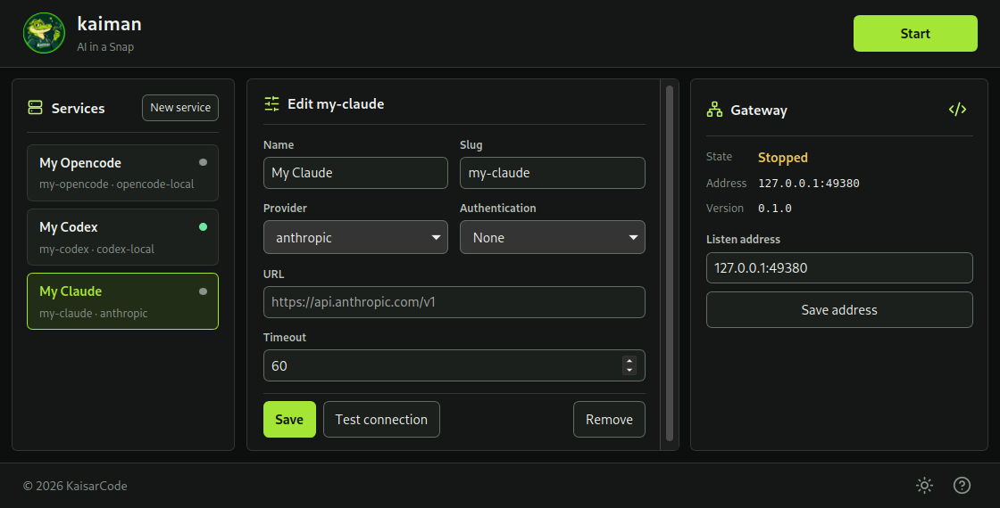

# kaiman

kaiman is a unified AI gateway that brings local and cloud AI services
together in one place. Manage your connections, access models from different
providers and continue conversations through a single OpenAI-compatible
gateway.

## Quick start

Run the installer included in the Linux or Windows desktop distribution.
Open kaiman, add your AI services and start the gateway.

## Documentation

- [Providers](doc/providers.md) - supported AI services
- [Configuration](doc/configuration.md) - settings and credentials
- [Sessions](doc/sessions.md) - persistent conversations
- [CLI](doc/cli.md) - command-line and desktop usage
- [HTTP API](doc/http-api.md) - application integration
- [Public API](doc/api.md) - library integration
- [Build](doc/build.md) - building from source

## License

This project is distributed under the **GNU Lesser General Public License version 3 (LGPLv3)**.
